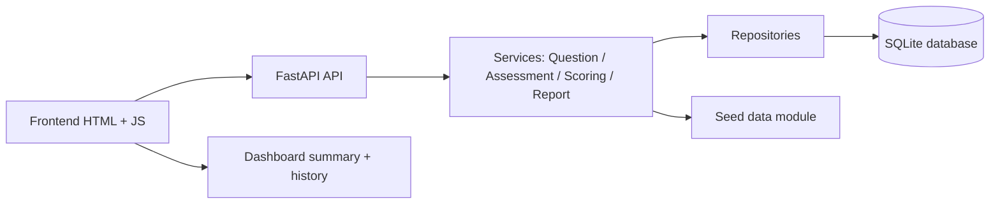

# SkillGauge

SkillGauge is a lightweight interview-readiness analyzer built with Python, FastAPI, SQLAlchemy, SQLite, and a vanilla JavaScript dashboard. It lets a candidate enter a name, choose one or more technical skills and a target role, complete a randomized assessment, and receive score feedback with strengths, weak areas, and recommendations.

## Features

- Candidate-driven assessment setup with target role selection
- Randomized multiple-choice question bank with 60+ seeded questions
- Per-skill and overall scoring
- Completed-assessment report with explanations and recommendations
- Candidate history and summary dashboard
- SQLite persistence with seeding that avoids duplicates
- Java DSA practice example in the `java-practice/` directory

## Technology stack

- Python 3.12+
- FastAPI
- SQLAlchemy
- SQLite
- Pydantic
- NumPy
- Pandas
- Pytest
- HTML5, CSS3, Vanilla JavaScript
- Chart.js via CDN fallback
- Java for DSA practice

## Architecture diagram



## Folder structure

```text
skillgauge/
├── app/
│   ├── __init__.py
│   ├── database.py
│   ├── main.py
│   ├── models/
│   │   ├── __init__.py
│   │   ├── answer.py
│   │   ├── assessment.py
│   │   ├── attempt_question.py
│   │   ├── question.py
│   │   └── skill.py
│   ├── repositories/
│   │   ├── __init__.py
│   │   ├── assessment_repository.py
│   │   └── question_repository.py
│   ├── routes/
│   │   ├── __init__.py
│   │   ├── assessments.py
│   │   ├── dashboard.py
│   │   ├── questions.py
│   │   └── skills.py
│   ├── schemas/
│   │   ├── __init__.py
│   │   ├── assessment.py
│   │   ├── question.py
│   │   └── skill.py
│   └── services/
│       ├── __init__.py
│       ├── assessment_service.py
│       ├── question_service.py
│       ├── report_service.py
│       └── scoring_service.py
├── data/
│   ├── __init__.py
│   └── seed_questions.py
├── frontend/
│   ├── app.js
│   ├── index.html
│   └── style.css
├── java-practice/
│   ├── DsaPractice.java
│   └── README.md
├── tests/
│   ├── conftest.py
│   └── test_skillgauge.py
├── .env.example
├── .gitignore
├── requirements.txt
├── README.md
└── skillgauge.db (created at runtime)
```

## Database relationships

- `Skill` has many `Question` rows.
- `Assessment` has many `AttemptQuestion` rows.
- `AttemptQuestion` belongs to one `Question` and one `Assessment`.
- `AttemptQuestion` has one `UserAnswer` row.

This enables stable question assignment during a single assessment attempt while keeping the same question set visible and immutable during that run.

## Setup on Windows

From the project root (`skillgauge`):

```powershell
python -m venv .venv
.\.venv\Scripts\Activate.ps1
python -m pip install -r requirements.txt
```

## Database initialization and seeding

The project creates the SQLite database automatically on application startup and seeds the question bank if needed.

```powershell
python -m uvicorn app.main:app --reload
```

The seeded question bank is idempotent and avoids duplicating skills or questions when the app restarts.

## Run the application

From the project root:

```powershell
python -m uvicorn app.main:app --reload
```

Open the app at:

```text
http://127.0.0.1:8000/
```

Swagger UI is available at:

```text
http://127.0.0.1:8000/docs
```

## API endpoints

| Method | Endpoint | Purpose |
| --- | --- | --- |
| GET | `/health` | Health check |
| GET | `/api/v1/skills` | List all skills |
| GET | `/api/v1/skills/{skill_id}` | Get one skill |
| GET | `/api/v1/questions` | List filtered questions |
| GET | `/api/v1/skills/{skill_id}/question-count` | Show eligible question counts |
| POST | `/api/v1/assessments` | Create a new assessment |
| GET | `/api/v1/assessments/{assessment_id}` | Retrieve assigned questions |
| POST | `/api/v1/assessments/{assessment_id}/submit` | Submit answers and score |
| GET | `/api/v1/assessments/{assessment_id}/report` | Return report with explanations |
| GET | `/api/v1/candidates/{candidate_id}/history` | Candidate history |
| GET | `/api/v1/dashboard/summary` | Local summary metrics |

## Testing

Run the automated tests with:

```powershell
pytest -q
```

The test suite verifies health, skill retrieval, assessment creation, scoring, report access, duplicate prevention, and persistence.

## Scoring methodology

The overall score is computed as:

```text
(correct_answers / total_questions) * 100
```

The result is described as an assessment-based indicator rather than a guarantee of hiring success. Unanswered questions are treated as incorrect for the denominator and score calculation.

## Design decisions and OOP principles

The code separates concerns into:

- `models` for persistence entities
- `repositories` for database access
- `services` for business logic and scoring
- `schemas` for request and response validation
- `routes` for HTTP endpoints

This reflects the Single Responsibility Principle and keeps the app maintainable for a small portfolio project.

## DSA concepts and complexity

- Hash maps/dictionaries are used to aggregate skill results.
- Sets and lists are used for unique question selection and duplicate prevention.
- Random sampling is used to select a subset of questions without replacement.
- Sorting is used to rank weak or strong skills.

Relevant complexity:

- Random sampling without replacement: average O(k) for selection within a list, with O(n) memory for candidate tracking.
- Aggregation with dictionaries: O(n) time over assessed questions.
- Sorting skill summaries: O(m log m), where m is the number of skills.

## Limitations and future enhancements

- The app uses a local SQLite database intended for a single developer workstation.
- There is no user authentication or multi-user account system.
- The readiness score is a product-defined estimate, not a validated hiring prediction.
- Future work could add authentication, per-user history, richer analytics, and external question sources.

## Important note about readiness score

The reported readiness percentage is an assessment-based indicator for learning and feedback. It is not a guarantee that the person will pass a real interview or be hired.
